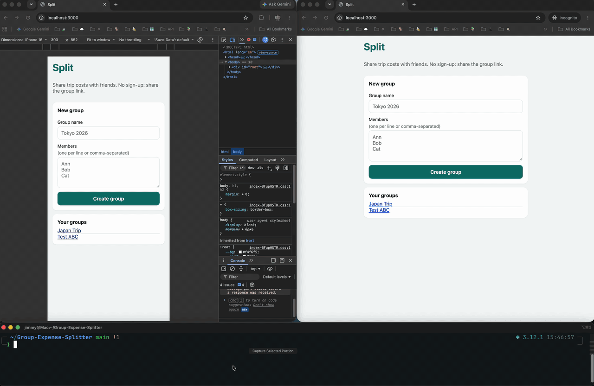
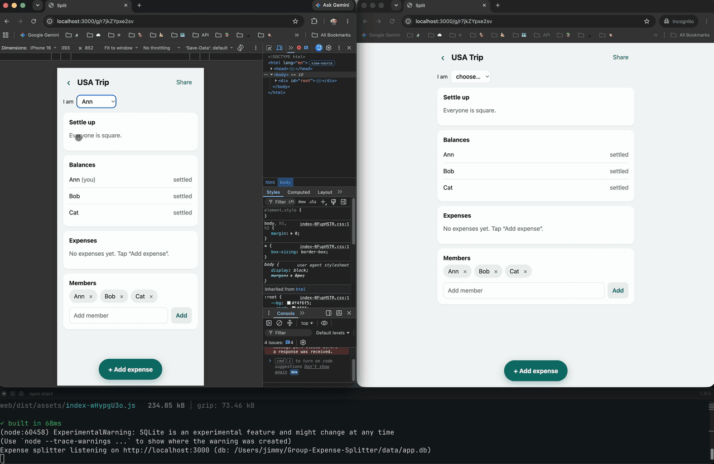
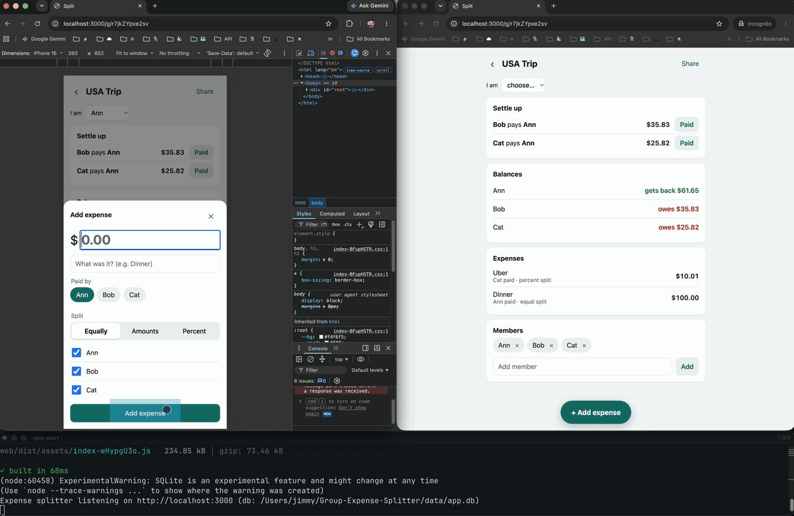
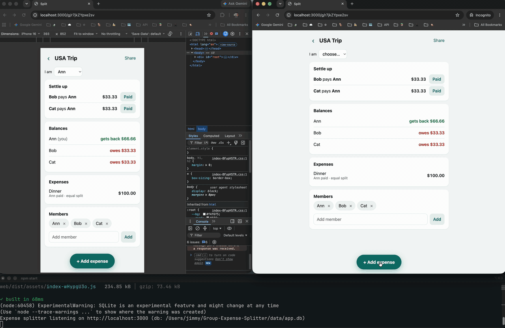
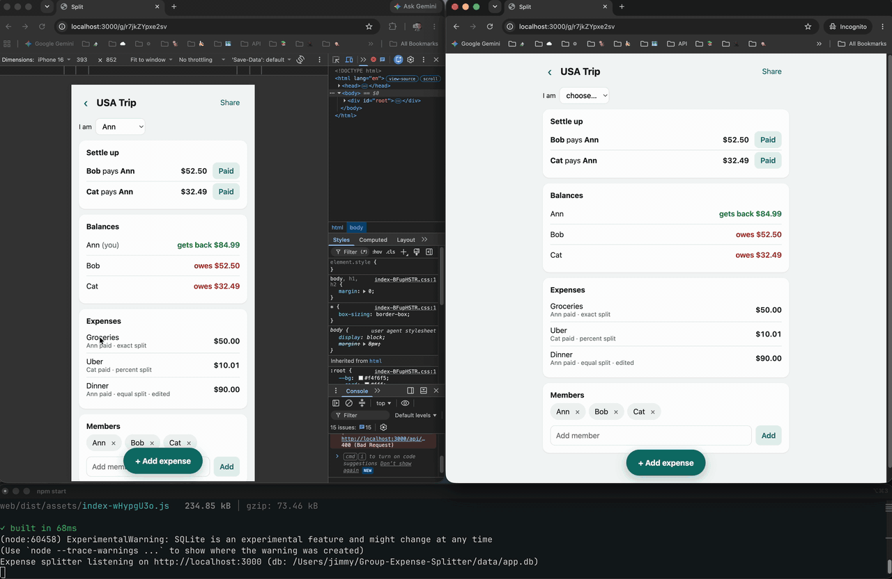
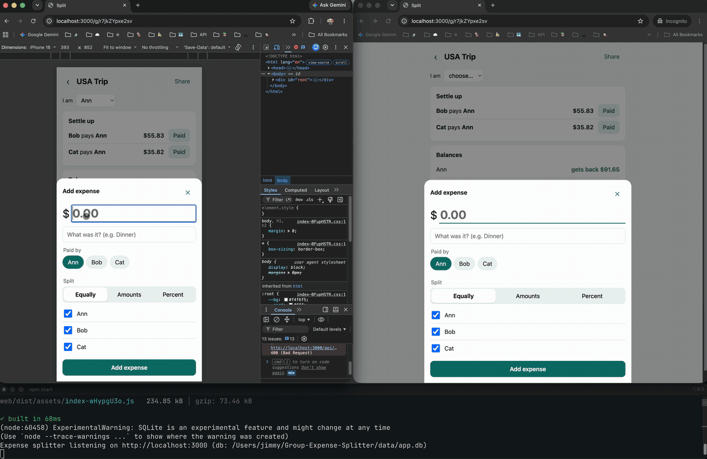
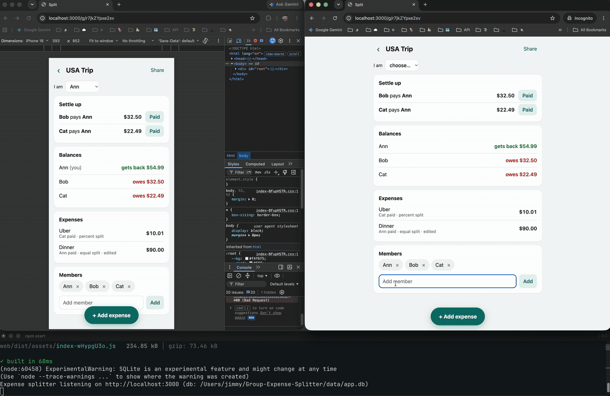
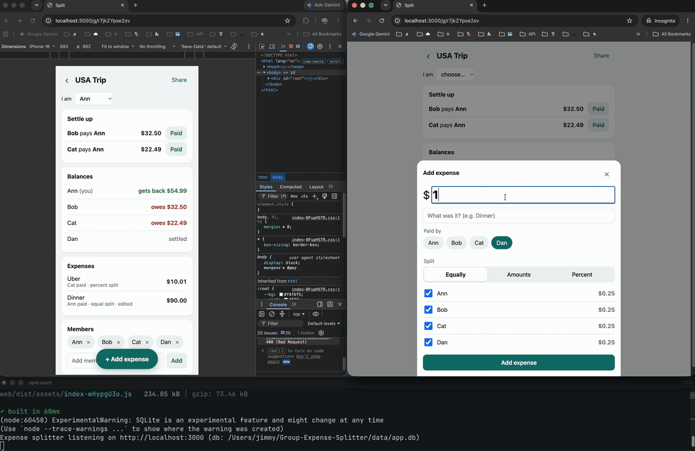
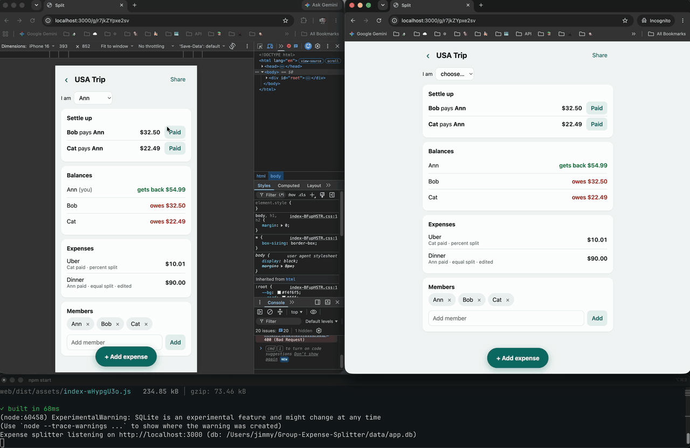
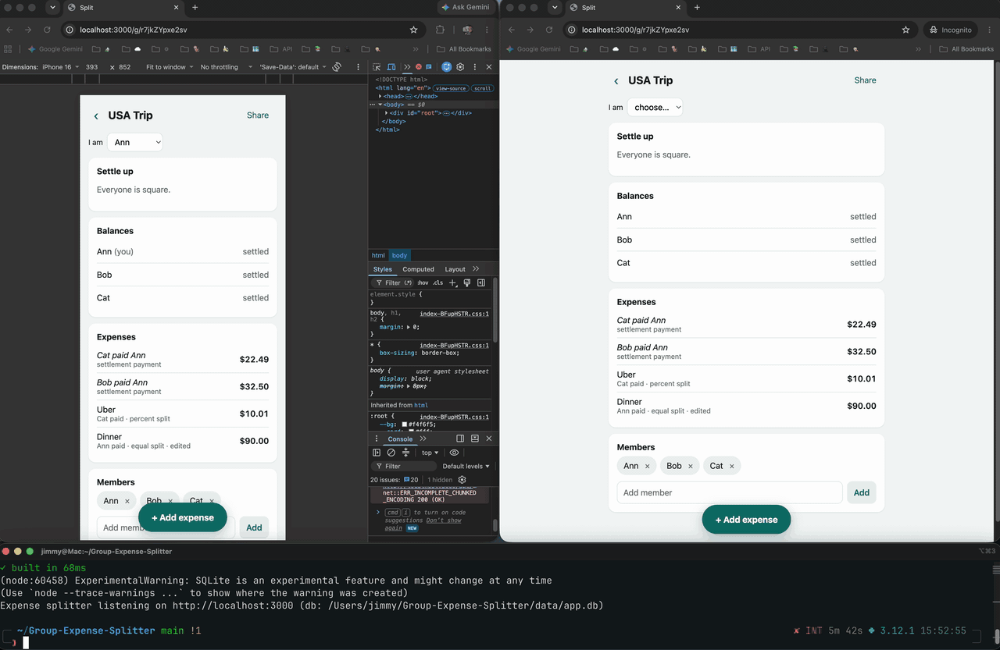

# Split — group expense splitter

A small full-stack app for friends splitting trip costs. Create a group, add members, log expenses
(split equally, by exact amounts, or by percentages), and see balances plus a "settle up" plan with
the fewest possible payments. Changes appear live in every open browser.

## Demo

Left: phone-sized browser (Ann). Right: a different browser (Bob). Bottom: the server.

### Create a group and share the link

### Add an expense: split equally

### Add an expense: split by exact amounts

### Add an expense: split by percentage

### Delete an expense

### Conflicting edits (optimistic concurrency control)

### Add a member

### Remove a member

### Settle up

### Data persistence


## Run it

Requires **Node.js ≥ 22.13** (uses the built-in `node:sqlite`, so there is nothing native to compile
and no database server to install).

```bash
git clone https://github.com/Jimmy-0/Group-Expense-Splitter.git
cd Group-Expense-Splitter
npm install
npm start            # builds the UI, serves UI + API on http://localhost:3000
```

Data lives in `data/app.db` (override with `DB_PATH=...`, port with `PORT=...`).

Other scripts:

```bash
npm run dev          # API with reload on :3000 + Vite dev server on :5173 (proxies /api)
npm test             # money logic + API integration tests (vitest)
npm run typecheck
```

Open the app on your phone using your machine's LAN IP (`npm run dev` binds Vite to all interfaces).
Over plain `http://<LAN-IP>` the browser hides the share/clipboard APIs, so "Share" shows the link to
copy instead.

### API docs (Swagger)

With the server running (`npm start` or `npm run dev`), open **http://localhost:3000/api/docs**.
The raw OpenAPI 3.1 spec is at http://localhost:3000/api/openapi.json, so you can import it into
Postman or Insomnia or generate a client from it.

To try a full flow in the browser:

1. **Groups → `POST /api/groups` → Try it out → Execute.** The example creates "Lisbon trip" with
   Ann, Bob and Cat. Copy `id` and the member `id`s from the response.
2. **Expenses → `POST /api/groups/{groupId}/expenses`.** Paste the group id, then pick an example from
   the *Examples* dropdown (`equal`, `exact`, `percent`). The examples use member ids 1, 2 and 3,
   which only match the first group in a fresh database; otherwise replace them with the ids from
   step 1.
3. **Groups → `GET /api/groups/{groupId}`** shows balances and the settle-up plan, computed by the
   server.
4. **Settle up → `POST /api/groups/{groupId}/settlements`**: send one line of `settlements` from
   step 3. Sending it a second time returns `409`.
5. To edit or delete, pass the expense's current `version`. A stale version returns `409`.

Try bad input too: `"amount": "1.005"` or percentages that don't add up to 100 return `400` with a
readable message. `GET /api/groups/{groupId}/events` is a Server-Sent Events stream. It is
documented in the spec, but Swagger UI can't display it; use
`curl -N http://localhost:3000/api/groups/<id>/events` instead.

## Stack

TypeScript end to end: Express 5 + zod on the server, SQLite via `node:sqlite`, React 19 + Vite on
the client. One language means the request/response types (`shared/types.ts`) and the money code
(`shared/money.ts`) are literally the same files on both sides.

```
shared/money.ts     pure money logic: parsing, rounding, splits, balances, settle-up
shared/types.ts     API types
shared/names.ts     member-name normalization (uniqueness key)
server/db.ts        schema, migration, transaction helper
server/app.ts       HTTP API, validation, SSE change feed
server/openapi.ts   OpenAPI 3.1 spec served to Swagger UI
server/index.ts     entry point; also serves the built UI
server/*.test.ts    unit tests (money) and HTTP integration tests (API)
web/src/            React UI
```

## Design decisions

### Money

- **Integer cents everywhere.** Amounts travel as decimal strings (`"100.00"`) and are parsed with a
  regex into integer cents; JSON numbers are rejected for money so `0.1 + 0.2` problems cannot enter.
  Max 2 decimals, must be > 0, capped at $10M so every intermediate product stays exact. `.5` and `5.`
  are accepted. The API is strict (no `$`, no thousands separators); the UI normalizes what people
  type on phones first (`$1,234.50` → `1234.50`, `12,5` → `12.5`).
- **Rounding = largest remainder method.** Each person gets the floor of their exact share; the
  leftover cents go to the largest fractional remainders, ties broken by member order. Shares always
  add up to the total exactly. `$100 / 3` → `33.34, 33.33, 33.33`. Percent splits use the same code
  (`$10.01` at 50/25/25 → `5.01, 2.50, 2.50`).
- **Exact splits must add up to the total, percentages to exactly 100%.** The error says by how
  much it's off. I chose to reject rather than silently adjust, because silently moving money is
  the kind of bug people notice on a shared bill.
- **Balances** are `paid − owed` per member and always sum to zero.
- **Settle-up is truly minimal**, not just greedy. With *k* people holding non-zero balances, the
  optimum is *k − p* payments where *p* is the max number of disjoint zero-sum subgroups. A bitmask
  DP finds *p* (O(2ᵏ·k)); each subgroup is then settled greedily. The tests check this against an
  independent brute-force oracle and include a case where plain greedy needs 6 payments and the
  optimum is 5. Above 18 people it falls back to greedy (still ≤ n−1 payments), since the exact
  problem is NP-hard.
- The client imports the same `shared/money.ts` to show a live per-person preview while typing, but
  the **server is authoritative**: it recomputes everything and stores the resolved cents.

### API

Interactive docs are at **http://localhost:3000/api/docs** (see [API docs (Swagger)](#api-docs-swagger)).

| Method | Path | |
| --- | --- | --- |
| `POST` | `/api/groups` | `{ name, members: string[] }` |
| `GET` | `/api/groups/:id` | members, expenses, balances, settlements (all computed server-side) |
| `POST` | `/api/groups/:id/members` | `{ name }` |
| `DELETE` | `/api/groups/:id/members/:memberId` | archives; 409 if used in an active expense |
| `POST` | `/api/groups/:id/expenses` | `{ description, amount, paidBy, split }` |
| `PUT` | `/api/groups/:id/expenses/:expenseId` | same body + `version` |
| `DELETE` | `/api/groups/:id/expenses/:expenseId?version=n` | soft delete |
| `GET` | `/api/groups/:id/expenses/:expenseId/history` | every revision |
| `POST` | `/api/groups/:id/settlements` | `{ from, to, amountCents }`: record a settle-up payment; 409 unless it's in the current plan |
| `GET` | `/api/groups/:id/events` | Server-Sent Events: `change` whenever the group changes |

`split` is one of `{ mode: "equal", memberIds }`, `{ mode: "exact", shares: [{ memberId, amount }] }`,
`{ mode: "percent", shares: [{ memberId, percent }] }`.

Validation: zod for shape (400 with per-field details), then money rules (400 with a readable
message), then group membership (payer and every share must be an active member of *this* group;
the error names the person, e.g. when someone was removed while a form was open).
404 for unknown groups/expenses, 409 for conflicts, 413 for oversized bodies.

### Data model

```
groups(id, name, created_at)
members(id, group_id, name, name_key, archived_at)        unique active name_key per group
expenses(id, group_id, description, amount_cents, paid_by, split_mode, is_payment,
         version, created_at, updated_at, deleted_at)
expense_splits(expense_id, member_id, input_value, amount_cents)
expense_revisions(expense_id, version, action, snapshot, created_at)   append-only
```

- `expense_splits` stores both what the user typed (`input_value`: cents or basis points) and the
  resolved `amount_cents`. Balances only read resolved cents; the edit form round-trips the input.
- **Edits keep history consistent:** an edit replaces the splits and appends a revision snapshot in
  one transaction; a delete is a soft delete plus a `delete` revision. Nothing is ever overwritten
  without a trace, and a failed edit leaves the previous splits untouched.
- **Optimistic concurrency:** every write must send the `version` it was based on. If two people
  edit the same expense, the second gets a 409 instead of silently overwriting the first.
- **Members are archived, never deleted**, and only when they are not in any active expense, so old
  revisions still resolve names and balances can never reference a missing person.
- **Member names are unique per group regardless of case or Unicode form** (`Émile` = `émile`).
  SQLite's `NOCASE` only folds ASCII, so the app stores `name_key` (NFKC + lowercase) and indexes
  that. Older databases are migrated in place on startup.
- **At most 50 active members per group**, the same as the split-size limit, so an equal split can
  always include everyone.
- **"Paid" on a settle-up line** calls `POST /settlements`, which records a normal expense
  (`is_payment = 1`) where the debtor pays and the creditor owes the full amount. The server checks
  inside the write transaction that this exact transfer is still in the current plan, so a double
  tap or two people pressing "Paid" at once records it only once. No separate payments table, so
  balance math stays a single code path. Editing a payment keeps it marked as a payment.

### Frontend

- Mobile first. "Add expense" is a large fixed button; the sheet opens with the amount field focused
  and the numeric keypad (`inputmode="decimal"`), payer pre-selected from "I am" (remembered per
  device), split defaulting to *everyone equally*. Typical entry: amount, description, tap Save.
- The settle-up plan is the first thing on the page ("Bob pays Ann $33.33"), then balances in
  green/red.
- Live sync: each visible page holds an `EventSource`; on `change` it refetches the group snapshot.
  Hidden tabs close their stream and refetch when they become visible again, because browsers allow
  only ~6 HTTP/1.1 connections per host and background streams would starve the foreground tab.
  After any failed action (e.g. a 409) the page also refetches, since a failure usually means the
  view is stale. `EventSource` reconnects by itself after a server restart.

## Tradeoffs and limitations

- **No authentication.** Access is by unguessable group link (72 random bits). Fine for friends on a
  trip; not for anything sensitive.
- **Single currency** per group, no currency symbol choice.
- **SSE fan-out is in-process.** Running several server instances would need Redis pub/sub (or
  Postgres `LISTEN/NOTIFY`) behind `ChangeFeed`.
- **SQLite** is the right size here (one file, transactional, survives restarts). Moving to Postgres
  would mostly mean swapping `db.ts`.
- Leftover cents in equal splits always go to the earliest members in the list, so across many
  expenses the same person can absorb a few extra cents. Rotating the remainder would be fairer.
- `node:sqlite` still prints an "experimental" warning on startup in some Node versions; it's
  harmless.

## What I'd do next

- Rotate or randomize leftover cents across expenses so nobody always pays the extra cent.
- Multi-currency with a per-expense exchange rate captured at entry time.
- Show who changed what (needs lightweight identity: the "I am" choice could be sent with writes).
- Undo for deletes (the revision table already has everything needed).
- Playwright end-to-end tests for the UI flows I verified manually.
- Itemized receipts (split individual line items) and receipt photos.

## How I worked with the AI assistant

I used omp AI agent harness tool for cost optimization concern throughout this project. I made the design decisions up front (integer cents, largest-remainder rounding, server-authoritative math, versioned soft-deleted expenses with a
revision log, SSE for live updates) and reviewed them before any code was written; the assistant then spawn sub agents with predefined prompt to do the tasks including implementation, wrote the tests, and end to end verifications.